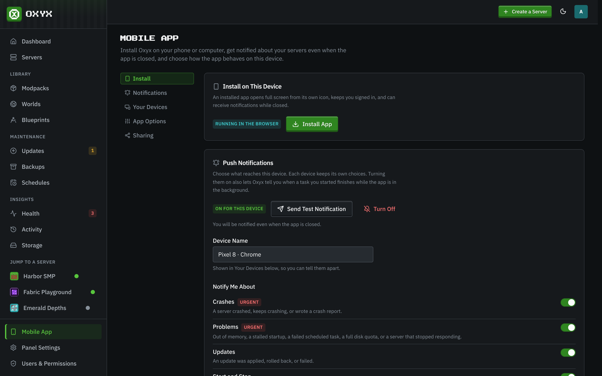
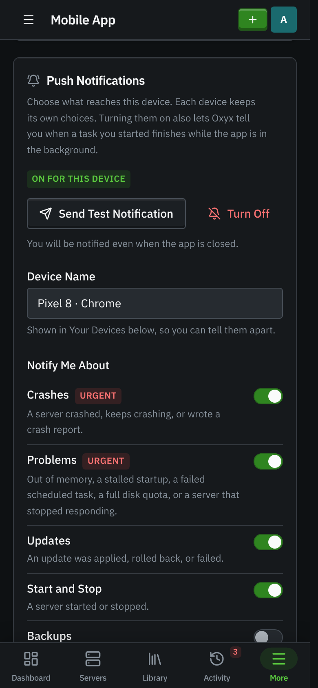

# Mobile App

Oxyx installs as an app on phones, tablets and computers. Installed, it opens full screen from its
own icon, keeps you signed in, and can send push notifications about your servers even when it is
closed. Open **Mobile App** in the sidebar (or in your account menu). Every
role can use it: notifications and app options are personal, and each device keeps its own.

## Installing

Press **Install App** on the Mobile App page or in your account menu. Chrome, Edge and Samsung
Internet open their own install prompt. Other browsers show the steps for that browser: **Share**
then **Add to Home Screen** on iPhone and iPad, **File** then **Add to Dock** in Safari on a Mac,
and the browser menu on Android and other computers. Once Oxyx runs as the installed app, the
button hides and the page shows **Installed App**.

Android and computers need the panel on a secure (HTTPS) address, for example behind a reverse
proxy with a certificate. On plain HTTP the page says so. iPhone and iPad install over plain HTTP,
but notifications there need HTTPS, iOS 16.4 or later, and the installed app.

## Push notifications

Press **Turn On for This Device** and allow notifications when the browser asks. Then choose what
this device hears about, and press **Save Choices**:

| Kind           | What sends it                                                                                                      | On by default |
| -------------- | ------------------------------------------------------------------------------------------------------------------ | ------------- |
| Crashes        | A server crashed, keeps crashing, or wrote a crash report.                                                         | Yes (urgent)  |
| Problems       | Out of memory, a stalled startup, a failed scheduled task, a full disk quota, or a server that stopped responding. | Yes (urgent)  |
| Updates        | An update was applied, rolled back, or failed.                                                                     | Yes           |
| Start and Stop | A server started or stopped.                                                                                       | No            |
| Backups        | A backup was made or restored.                                                                                     | No            |
| Moderation     | A player was banned or kicked.                                                                                     | No            |
| Player Joins   | Someone joined a server.                                                                                           | No            |

- **Servers:** every server you can view (including new ones), or only the ones you tick.
- **Quiet hours:** mute notifications between two times, in the panel's timezone. **Let Crashes and
  Problems Through** keeps the urgent kinds coming at night.
- **Send Test Notification** checks the whole path to the device.

You are only ever notified about servers you are allowed to view. Panel-wide events go to admins
only. Urgent notifications stay on screen until you dismiss them and vibrate in a distinct pattern;
tapping any notification opens the right page (a crash opens the server's crash reports).

On iPhone and iPad, notifications work only in the installed app, on iOS 16.4 or later.

### Your devices

**Your Devices** lists every device where you turned notifications on, when each was last
notified, and any delivery problem. **Test** sends one to that device, **Remove** stops it. A device
the push service reports as gone (the app was removed, or notifications were turned off in the
system settings) is removed automatically.

## App options

Saved on the device you change them on:

- **Alert Count on the App Icon:** the home-screen icon shows how many health alerts are waiting.
- **Keep the Screen On in the Console:** the phone does not lock while you watch a console.
- **Vibrate on Server Actions:** a short buzz when you start, stop or restart a server (Android).
- **Open the App On:** the page the app opens on from its icon: the dashboard, servers, health,
  backups, activity, or a particular server or its console.

## Sharing links to Oxyx

On Android the installed app appears in the share sheet. Share the page of a mod or plugin from
Modrinth, CurseForge, Hangar or SpigotMC to **Oxyx**, pick a server, and its Mods tab opens **Add
Mod by URL** with the link filled in. Only servers you may add content to are offered.

## How it works

The panel sends Web Push through the push service your browser uses (Google for Chrome and Android,
Mozilla for Firefox, Apple for Safari, Microsoft for Edge on Windows). Notifications are encrypted
for the device, so the push service cannot read them. The panel creates its own signing key the
first time it is needed and keeps it encrypted in its database. It only ever sends to those push
services, never to any other address. Set `PUSH_CONTACT` (a `mailto:` or `https:` address) to change
the contact the panel gives push services; it defaults to the project page.
